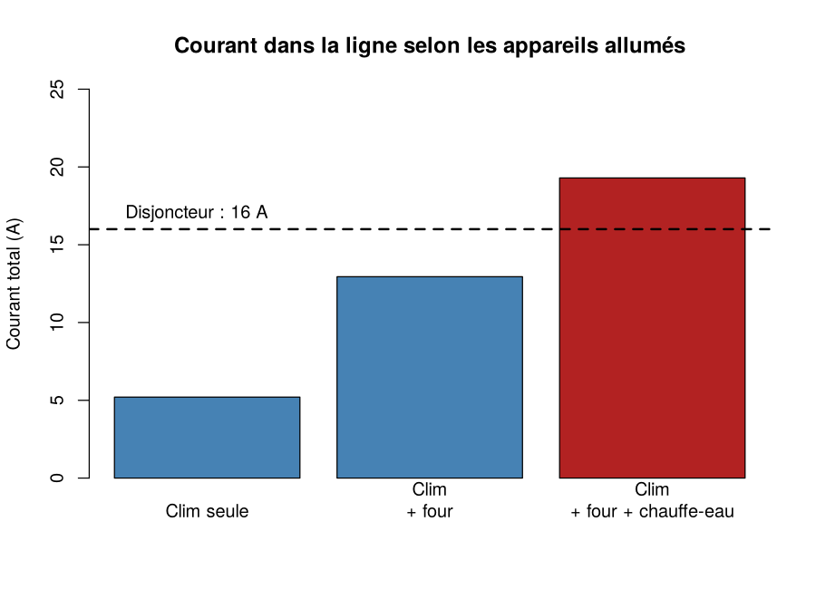

# Résolution directe de systèmes linéaires en R

Méthodes de **Gauss**, **LU** et **Cholesky**, appliquées à un problème du quotidien : pourquoi le disjoncteur saute quand on allume trop d'appareils.

## La situation

Une seule ligne électrique alimente trois appareils : la **clim** (1200 W), le **four** (1800 W) et le **chauffe-eau** (1500 W). Le disjoncteur coupe à **16 A**.

```
Compteur --fil-- (1) clim --fil-- (2) four --fil-- (3) chauffe-eau
```

- Avec la clim et le four : tout fonctionne.
- On ajoute le chauffe-eau : le disjoncteur saute.

## Du circuit au système linéaire

Les fils résistent un peu au courant, donc la tension baisse le long de la ligne. On cherche la tension **V1, V2, V3** reçue par chaque appareil.

Deux lois suffisent :

- **Loi d'Ohm** : courant = différence de tension / résistance.
- **Loi des nœuds de Kirchhoff** : à chaque nœud, le courant qui arrive est égal au courant qui repart. C'est elle qui explique le disjoncteur : le courant dans le premier fil est la **somme** des courants de tous les appareils allumés.

On obtient le système **G · V = I** (3 × 3 pour 3 appareils, *n* × *n* pour *n* appareils) :

| | Signification |
|---|---|
| **G** | conductances des fils et des appareils (connues) |
| **V** | tensions aux appareils (**inconnues**) |
| **I** | courant imposé par le compteur (connu) |

La matrice G est symétrique et définie positive, donc Cholesky s'applique.

## Les trois méthodes

| Méthode | Idée | Fichier |
|---|---|---|
| Gauss | rendre le système triangulaire, puis remonter | `R/gauss.R` |
| LU | Gauss « avec mémoire » : `P·A = L·U`, utile quand seul le second membre change | `R/lu.R` |
| Cholesky | `A = L·Lᵀ`, pour les matrices symétriques définies positives | `R/cholesky.R` |

Complexité : Gauss et LU environ 2n³/3 opérations, Cholesky environ n³/3. Une résolution triangulaire coûte de l'ordre de n².

## Résultats

| Appareils allumés | Courant total | Disjoncteur (16 A) |
|---|---|---|
| Clim seule | 5,2 A | tient |
| Clim + four | 12,9 A | tient |
| Clim + four + chauffe-eau | 19,3 A | **saute** |

Avec les trois appareils, les tensions reçues sont 228,1 V, 226,7 V et 226,0 V (le compteur fournit 230 V). Les trois méthodes donnent les mêmes valeurs que `solve()` de R.



## Utilisation

Depuis le dossier du projet :

```
Rscript exemple.R
```

## Structure

```
R/
  outils.R      résolution des systèmes triangulaires
  gauss.R       méthode de Gauss
  lu.R          décomposition LU
  cholesky.R    décomposition de Cholesky
  circuit.R     l'installation électrique
exemple.R       démonstration
resultats/      graphique produit par exemple.R
```
